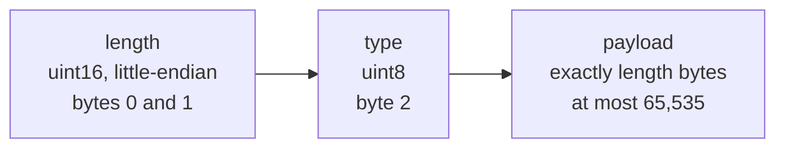
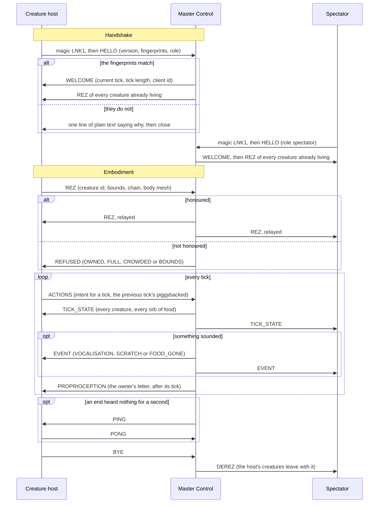
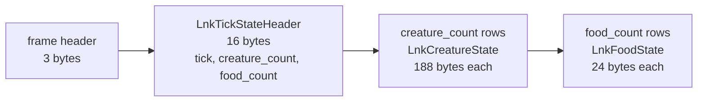

# The Wire, Drawn

A picture book of the Link protocol, version 12. The contract of record is the C header
[`include/lnk/lnk_protocol.h`](../include/lnk/lnk_protocol.h): it pins every byte, and when this page
and the header disagree, the header is right. What the messages *mean* - the tick lifecycle, the trust
stance, the deferred list - is ruled in the flagship's
[docs/TOPOLOGY.md](https://github.com/ai-quokka-wannabe/tron-grid-lite/blob/main/docs/TOPOLOGY.md).
This page only draws what both of them already say.

---

## Who Talks to Whom

Master Control is the server and holds the world; everything else is a client. A client says in its
HELLO which of the two roles it plays: a **spectator** (the Grid window a human watches and listens
through) or a **creature host** (the Grid hosting a Program, such as rc-worm, and its senses). Every
one of them loads the same `link` library, so both ends of every arrow in the
[README's picture](../README.md) run one implementation.

A spectator never sends ACTIONS or REZ: the library refuses to stage either on a spectator
connection, and the server half hangs up on one that arrives.

---

## A Frame on the Wire

Every message after the handshake travels in one frame: three bytes of header, little-endian, then
exactly as many payload bytes as the header says. There is no struct for the header - a C struct of a
`uint16_t` and a `uint8_t` would be padded to four bytes - so it is read and written as bytes.

The receiver checks the length against the type *before* copying anything: a fixed-size message must
be exactly its struct's size, and the three variable-size ones (REZ, TICK_STATE, PROPRIOCEPTION) must
match their own counts exactly. A frame that does not fit is refused whole, never partially read.

---

## The Twelve Messages

| Type | Message | Direction | Payload bytes |
|-----:|---------|-----------|---------------|
| 1 | HELLO | client to server, first frame after the magic | 48 |
| 2 | WELCOME | server to client, accepting a HELLO | 24 |
| 3 | REZ | creature host to server; server to every client | 48 + 12 per vertex + 16 per triangle + 32 per material |
| 4 | TICK_STATE | server to every client, every tick | 16 + 188 per creature + 24 per orb of food |
| 5 | ACTIONS | creature host to server | 96 |
| 6 | EVENT | server to every client | 32 |
| 7 | DEREZ | server to every client; a creature host may send one for a creature it owns | 16 |
| 8 | PING | either direction | 8 |
| 9 | PONG | either direction, answering a PING | 8 |
| 10 | BYE | either direction | 0 |
| 11 | PROPRIOCEPTION | server to the one host that owns the creature | 160 + 52 per contact |
| 12 | REFUSED | server to the one host whose REZ it did not honour | 16 |

Type 0 is invalid, deliberately, so a zeroed buffer read as a message refuses loudly. An EVENT is one
of three kinds - VOCALISATION, SCRATCH or FOOD_GONE - and a REFUSED names one of four reasons -
OWNED, FULL, CROWDED or BOUNDS.

---

## A Session's Life

One creature host and one spectator in a world Master Control runs. The handshake is the same for
both roles; only the host rezzes a creature and stages ACTIONS.

What the picture cannot show:

- **Late join is not a special case.** WELCOME is followed by the REZ of every live creature and then
  the next TICK_STATE, whether the client arrived first or an hour late.
- **TICK_STATE is the whole settled world, every tick** - no deltas, no acknowledgements.
- **ACTIONS carry the previous tick's intent beside the new one**, so one lost or late message loses
  nothing. A silent network gets the last accepted intent repeated for one tick, then a zeroed coast.
- **An EVENT is never load-bearing state.** A client that misses one has missed a sound, not the world.
- **PROPRIOCEPTION is a letter, not a broadcast:** only the host that owns the creature receives it,
  and a spectator never does.
- **BYE is a courtesy, not a contract.** A power cut sends no BYE; an end that hears nothing for ten
  seconds declares the other dead, and a dead host's creatures stay in the world on the neutral reflex.
- **Refusals before WELCOME are text, not frames** - bad magic, a wrong fingerprint, an invalid role -
  because they happen before the two ends have agreed they speak the same frames.

---

## Inside a TICK_STATE

The one message that grows with the world. Its length must equal the header plus every row, checked
before any copy; the largest legal TICK_STATE (256 creatures, 64 orbs) is 49,680 bytes of payload,
under the framing's 65,535.

A creature's row carries its head's pose, velocity and voice, then its chain: how many segments it has
and the poses of up to seven trailing ones, in a fixed array so every row is the same size. REZ and
PROPRIOCEPTION follow the same pattern - a fixed header, then counted rows - and their exact rules sit
beside their structs in the header.
